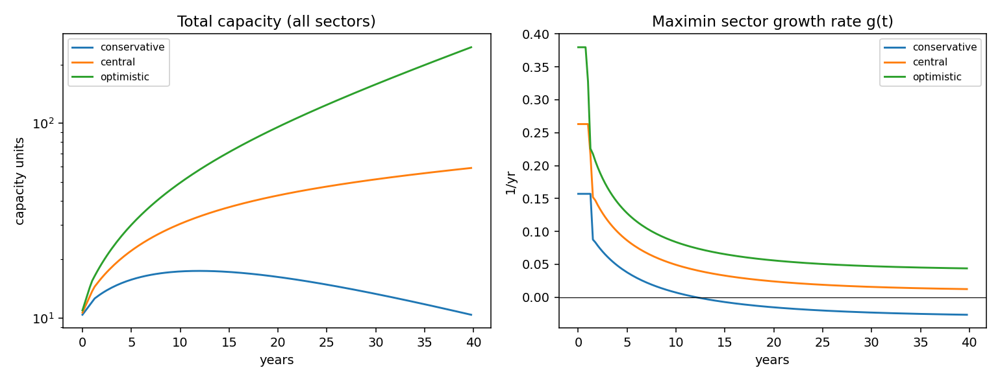
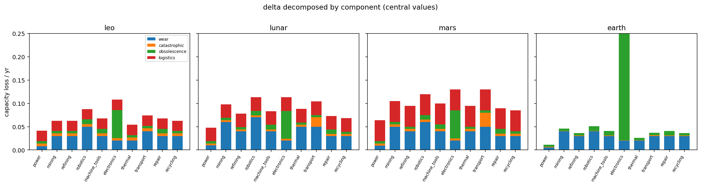
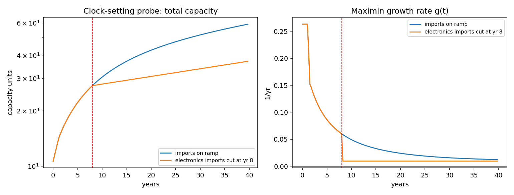
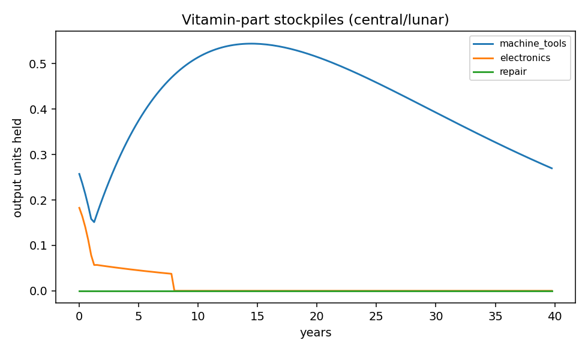
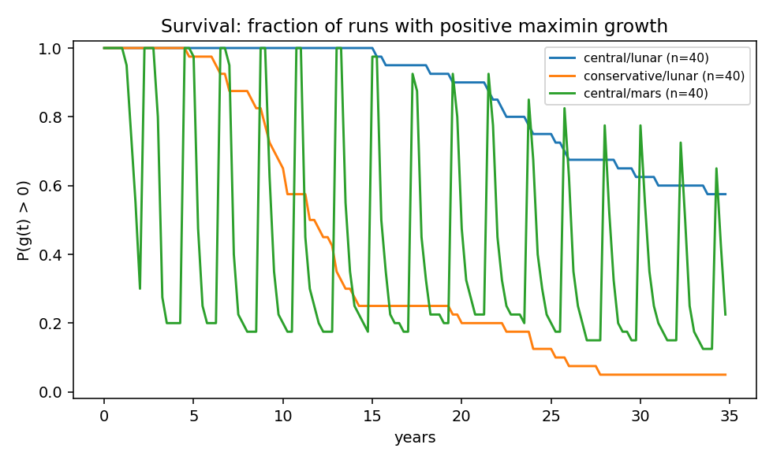
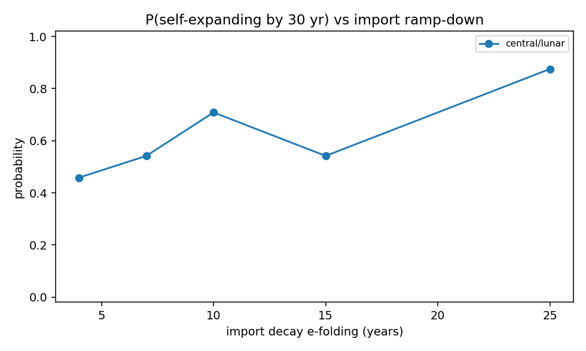

# RSI model run report — 2026-07-27

All replication/doubling times below are MODEL OUTPUTS. No single trajectory is
"the" answer: results span assumption sets (conservative/central/optimistic,
`params/assumptions.yaml`) and Monte Carlo over anchored ranges
(`params/anchors.yaml`). Structural coefficients are ASSUMPTION-class.

## Deterministic sweeps (central anchor values)

| set | environment | g @10yr | g @30yr | doubling (yr) | last binding sector |
|---|---|---|---|---|---|
| conservative | leo | -0.002 | -0.010 | never | mining |
| conservative | lunar | +0.007 | -0.023 | never | electronics |
| conservative | mars | -0.064 | +0.042 | never | electronics |
| central | leo | +0.041 | +0.031 | 15.0 | mining |
| central | lunar | +0.049 | +0.016 | 4.8 | electronics |
| central | mars | -0.023 | +0.074 | never | electronics |
| optimistic | leo | +0.096 | +0.069 | 6.2 | mining |
| optimistic | lunar | +0.084 | +0.047 | 3.0 | electronics |
| optimistic | mars | +0.007 | +0.104 | 4.8 | electronics |

## Monte Carlo (anchored ranges + common-cause shocks)

- [central/lunar] expanding @30yr: 25/40 = 0.62 (95% CI 0.47-0.76) | doubling: 4.9 yr (IQR 4.4-5.8, n=40) | binds: electronics 97%, machine_tools 3%
  (shocks/run: 17.2; q jitter sigma=0.1, ASSUMPTION-class)
- [conservative/lunar] expanding @30yr: 2/40 = 0.05 (95% CI 0.01-0.17) | doubling: 11.2 yr (IQR 8.8-14.8, n=9) | binds: electronics 81%, repair 16%, machine_tools 2%
  (shocks/run: 17.2; q jitter sigma=0.1, ASSUMPTION-class)
- [central/mars] expanding @30yr: 31/40 = 0.78 (95% CI 0.62-0.88) | doubling: 11.0 yr (IQR 8.8-12.7, n=14) | binds: electronics 88%, power 8%, machine_tools 5%
  (shocks/run: 24.1; q jitter sigma=0.1, ASSUMPTION-class)

## Minimum-cut-set analysis

**central/lunar** (horizon 30 yr, 74 simulations)
- baseline self-expanding: yes
- no import cut set prevents self-expansion by the horizon (imports accelerate but are not load-bearing at these central values)
- indispensable sectors (capacity knockout unrecoverable): power, mining, robotics, machine_tools, electronics, thermal, transport, repair

**central/leo** (horizon 30 yr, 138 simulations)
- baseline self-expanding: yes
- no import cut set prevents self-expansion by the horizon (imports accelerate but are not load-bearing at these central values)
- indispensable sectors (capacity knockout unrecoverable): power, mining, robotics, machine_tools, electronics, thermal, transport

## Figures

## Parameter provenance (central/lunar)

| quantity | value | source_class | anchor | note |
|---|---|---|---|---|
| delta.wear[power] | 0.0099 | peer_reviewed | delta.wear_space_solar | GEO telemetry, 11 sats (2018); GaAs low, Si high |
| delta.wear[mining] | 0.0600 | ASSUMPTION | — | environments.yaml |
| delta.wear[refining] | 0.0400 | ASSUMPTION | — | environments.yaml |
| delta.wear[robotics] | 0.0700 | ASSUMPTION | — | environments.yaml |
| delta.wear[machine_tools] | 0.0400 | ASSUMPTION | — | environments.yaml |
| delta.wear[electronics] | 0.0200 | ASSUMPTION | — | environments.yaml |
| delta.wear[thermal] | 0.0500 | ASSUMPTION | — | environments.yaml |
| delta.wear[transport] | 0.0500 | ASSUMPTION | — | environments.yaml |
| delta.wear[repair] | 0.0300 | ASSUMPTION | — | environments.yaml |
| delta.wear[recycling] | 0.0300 | ASSUMPTION | — | environments.yaml |
| delta.catastrophic[power] | 0.0040 | ASSUMPTION | — | environments.yaml |
| delta.catastrophic[mining] | 0.0040 | ASSUMPTION | — | environments.yaml |
| delta.catastrophic[refining] | 0.0040 | ASSUMPTION | — | environments.yaml |
| delta.catastrophic[robotics] | 0.0040 | ASSUMPTION | — | environments.yaml |
| delta.catastrophic[machine_tools] | 0.0040 | ASSUMPTION | — | environments.yaml |
| delta.catastrophic[electronics] | 0.0040 | ASSUMPTION | — | environments.yaml |
| delta.catastrophic[thermal] | 0.0040 | ASSUMPTION | — | environments.yaml |
| delta.catastrophic[transport] | 0.0200 | ASSUMPTION | — | environments.yaml |
| delta.catastrophic[repair] | 0.0040 | ASSUMPTION | — | environments.yaml |
| delta.catastrophic[recycling] | 0.0040 | ASSUMPTION | — | environments.yaml |
| delta.obsolescence[power] | 0.0050 | ASSUMPTION | — | environments.yaml |
| delta.obsolescence[mining] | 0.0050 | ASSUMPTION | — | environments.yaml |
| delta.obsolescence[refining] | 0.0050 | ASSUMPTION | — | environments.yaml |
| delta.obsolescence[robotics] | 0.0100 | ASSUMPTION | — | environments.yaml |
| delta.obsolescence[machine_tools] | 0.0100 | ASSUMPTION | — | environments.yaml |
| delta.obsolescence[electronics] | 0.0600 | ASSUMPTION | — | environments.yaml |
| delta.obsolescence[thermal] | 0.0050 | ASSUMPTION | — | environments.yaml |
| delta.obsolescence[transport] | 0.0050 | ASSUMPTION | — | environments.yaml |
| delta.obsolescence[repair] | 0.0100 | ASSUMPTION | — | environments.yaml |
| delta.obsolescence[recycling] | 0.0050 | ASSUMPTION | — | environments.yaml |
| delta.logistics[power] | 0.0291 | ASSUMPTION | delta.logistics_penalty_space | internal repair-chain overhead as capacity tax; UNANCHORED |
| delta.logistics[mining] | 0.0291 | ASSUMPTION | delta.logistics_penalty_space | internal repair-chain overhead as capacity tax; UNANCHORED |
| delta.logistics[refining] | 0.0291 | ASSUMPTION | delta.logistics_penalty_space | internal repair-chain overhead as capacity tax; UNANCHORED |
| delta.logistics[robotics] | 0.0291 | ASSUMPTION | delta.logistics_penalty_space | internal repair-chain overhead as capacity tax; UNANCHORED |
| delta.logistics[machine_tools] | 0.0291 | ASSUMPTION | delta.logistics_penalty_space | internal repair-chain overhead as capacity tax; UNANCHORED |
| delta.logistics[electronics] | 0.0291 | ASSUMPTION | delta.logistics_penalty_space | internal repair-chain overhead as capacity tax; UNANCHORED |
| delta.logistics[thermal] | 0.0291 | ASSUMPTION | delta.logistics_penalty_space | internal repair-chain overhead as capacity tax; UNANCHORED |
| delta.logistics[transport] | 0.0291 | ASSUMPTION | delta.logistics_penalty_space | internal repair-chain overhead as capacity tax; UNANCHORED |
| delta.logistics[repair] | 0.0291 | ASSUMPTION | delta.logistics_penalty_space | internal repair-chain overhead as capacity tax; UNANCHORED |
| delta.logistics[recycling] | 0.0291 | ASSUMPTION | delta.logistics_penalty_space | internal repair-chain overhead as capacity tax; UNANCHORED |
| q_scale[power] | 1.0000 | ASSUMPTION | — | environments.yaml |
| q_scale[mining] | 1.0000 | ASSUMPTION | — | environments.yaml |
| q_scale[refining] | 1.0000 | ASSUMPTION | — | environments.yaml |
| q_scale[robotics] | 1.0000 | ASSUMPTION | — | environments.yaml |
| q_scale[machine_tools] | 0.7000 | ASSUMPTION | — | environments.yaml |
| q_scale[electronics] | 0.1732 | ASSUMPTION | closure.space_electronics_q_scale | Fraction of the electronics sector's output mix producible off-world (the vitamin gap). UNANCHORED — no published measurement exists. Bounding argument: UPPER ~0.3 because advanced-node logic/memory (EUV lithography, metrology, ultra-pure feedstocks — the Section 13 residual chokepoint) is not locally closable in this scenario class, and boards/passives/power electronics are a minority of electronics value; LOWER ~0.1 because thick-film PCB, wiring, and discrete/power devices are plausibly closable with generic machine tools. THE single most results-driving number in Part I — see ROADMAP. |
| q_scale[thermal] | 1.0000 | ASSUMPTION | — | environments.yaml |
| q_scale[transport] | 0.9000 | ASSUMPTION | — | environments.yaml |
| q_scale[repair] | 1.0000 | ASSUMPTION | — | environments.yaml |
| q_scale[recycling] | 0.9000 | ASSUMPTION | — | environments.yaml |
| A matrix (all entries) | — | ASSUMPTION | — | assumptions.yaml set 'central' |
| q (incl. environment q_scale) | — | ASSUMPTION | — | assumptions.yaml + environments.yaml |
| import profile/budget/decay | — | ASSUMPTION | — | assumptions.yaml + environments.yaml |
| repair efficiency/spares | — | ASSUMPTION | — | assumptions.yaml |
| recycling recovery/profile/opex | — | ASSUMPTION | — | assumptions.yaml |
| stockpile sizes/shelf life | — | ASSUMPTION | — | assumptions.yaml |
| shock rates/fractions/groups | — | ASSUMPTION | — | environments.yaml |
