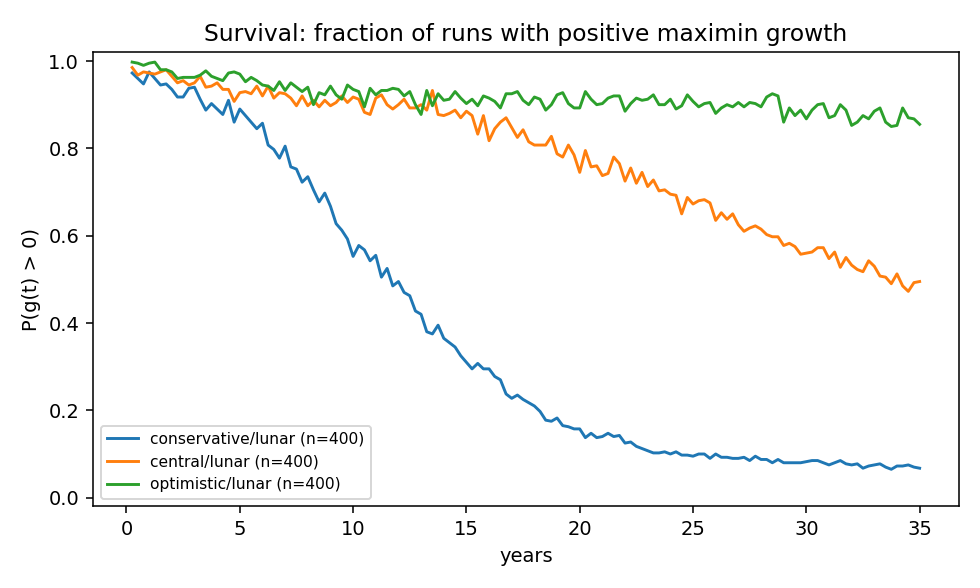
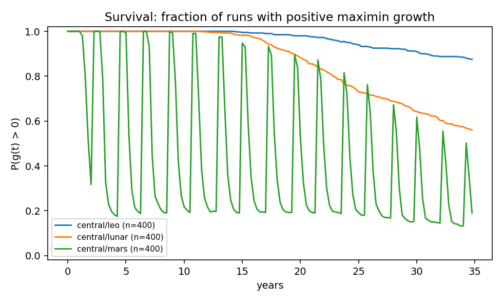
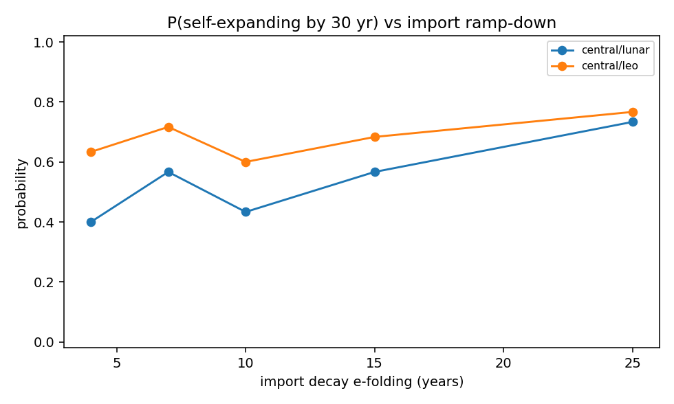

# RSI model run report — 2026-07-29

All replication/doubling times below are MODEL OUTPUTS. No single trajectory is
"the" answer: results span assumption sets (conservative/central/optimistic,
`params/assumptions.yaml`) and Monte Carlo over anchored ranges
(`params/anchors.yaml`). Structural coefficients are ASSUMPTION-class.

Metric definitions:
- **balanced doubling** — first t with λ(t) = min_j K_j(t)/K_j(0) ≥ 2: every
  modelled sector has at least twice its initial abstract capacity.
  Unit-invariant; it is a balanced-capacity event, not a commissioned second
  physical seed.
- **aggregate doubling** — first t with Σ_j K_j ≥ 2 Σ_j K_j(0). Depends on the
  arbitrary per-sector capacity units and can be reached by overbuilding easy
  sectors; kept for continuity only.
- **expanding @horizon** — instantaneous worst-case growth g > 0 at one step
  (endpoint 1). May still be import- or stock-supported.
- **sustained** — g > 0 at every step of the trailing window (endpoint 3).
- **binding sector/co-binding set** — unit-invariant finite response to a 1%
  relaxation of each material-balance supply. Rows within 5% of the largest
  positive response share fractional credit.

## Deterministic sweeps (central anchor values)

| set | environment | g @10yr | g @30yr | balanced dbl (yr) | aggregate dbl (yr) | last binding sector |
|---|---|---|---|---|---|---|
| conservative | leo | -0.015 | -0.023 | never | never | mining |
| conservative | lunar | +0.008 | -0.023 | never | never | electronics |
| conservative | mars | -0.064 | -0.064 | never | never | electronics |
| central | leo | +0.021 | +0.010 | never | never | mining |
| central | lunar | +0.050 | +0.016 | 4.2 | 4.2 | electronics |
| central | mars | -0.023 | -0.023 | 13.2 | 13.2 | electronics |
| optimistic | leo | +0.064 | +0.051 | 9.0 | 9.0 | mining |
| optimistic | lunar | +0.085 | +0.047 | 2.5 | 2.5 | electronics |
| optimistic | mars | +0.007 | +0.007 | 4.8 | 4.8 | electronics |

## Monte Carlo (anchored ranges + common-cause shocks)

- [conservative/leo] expanding @30yr: 12/400 = 0.03 (95% CI 0.02-0.05) | sustained [25-30]: 5/400 | pre-shock alloc endpoint: 13/400 | balanced dbl: never | aggregate dbl: never | λ@30 med 0.40 | binds: mining 100%, electronics 0%
  (shocks/run: 6.3; q jitter sigma=0.1, ASSUMPTION-class)
- [conservative/lunar] expanding @30yr: 33/400 = 0.08 (95% CI 0.06-0.11) | sustained [25-30]: 4/400 | pre-shock alloc endpoint: 36/400 | balanced dbl: 9.5 yr (IQR 8.5-12.6, n=51) | aggregate dbl: 9.0 yr (IQR 7.8-11.2, n=90) | λ@30 med 0.84 | binds: electronics 94%, power 5%, repair 1%
  (shocks/run: 16.9; q jitter sigma=0.1, ASSUMPTION-class)
- [conservative/mars] expanding @30yr: 2/400 = 0.01 (95% CI 0.00-0.02) | sustained [25-30]: 0/400 | pre-shock alloc endpoint: 2/400 | balanced dbl: never | aggregate dbl: never | λ@30 med 0.12 | binds: power 52%, electronics 48%, repair 0%
  (shocks/run: 25.5; q jitter sigma=0.1, ASSUMPTION-class)
- [central/leo] expanding @30yr: 267/400 = 0.67 (95% CI 0.62-0.71) | sustained [25-30]: 122/400 | pre-shock alloc endpoint: 277/400 | balanced dbl: 26.0 yr (IQR 23.2-30.0, n=67) | aggregate dbl: 24.5 yr (IQR 20.0-28.1, n=120) | λ@30 med 1.26 | binds: mining 98%, electronics 2%
  (shocks/run: 6.3; q jitter sigma=0.1, ASSUMPTION-class)
- [central/lunar] expanding @30yr: 224/400 = 0.56 (95% CI 0.51-0.61) | sustained [25-30]: 20/400 | pre-shock alloc endpoint: 255/400 | balanced dbl: 5.0 yr (IQR 4.2-6.2, n=379) | aggregate dbl: 4.5 yr (IQR 4.0-5.2, n=396) | λ@30 med 2.87 | binds: electronics 96%, power 4%, machine_tools 0%
  (shocks/run: 16.9; q jitter sigma=0.1, ASSUMPTION-class)
- [central/mars] expanding @30yr: 60/400 = 0.15 (95% CI 0.12-0.19) | sustained [25-30]: 4/400 | pre-shock alloc endpoint: 66/400 | balanced dbl: 11.0 yr (IQR 8.0-11.2, n=33) | aggregate dbl: 9.2 yr (IQR 7.2-13.2, n=149) | λ@30 med 0.55 | binds: electronics 62%, power 38%, machine_tools 0%
  (shocks/run: 24.4; q jitter sigma=0.1, ASSUMPTION-class)
- [optimistic/leo] expanding @30yr: 387/400 = 0.97 (95% CI 0.95-0.98) | sustained [25-30]: 173/400 | pre-shock alloc endpoint: 400/400 | balanced dbl: 10.8 yr (IQR 9.2-12.8, n=399) | aggregate dbl: 9.5 yr (IQR 8.5-11.0, n=400) | λ@30 med 4.61 | binds: mining 86%, electronics 14%
  (shocks/run: 6.3; q jitter sigma=0.1, ASSUMPTION-class)
- [optimistic/lunar] expanding @30yr: 347/400 = 0.87 (95% CI 0.83-0.90) | sustained [25-30]: 56/400 | pre-shock alloc endpoint: 394/400 | balanced dbl: 2.8 yr (IQR 2.5-3.2, n=400) | aggregate dbl: 2.8 yr (IQR 2.5-3.0, n=400) | λ@30 med 8.20 | binds: electronics 97%, power 3%, machine_tools 0%
  (shocks/run: 16.9; q jitter sigma=0.1, ASSUMPTION-class)
- [optimistic/mars] expanding @30yr: 195/400 = 0.49 (95% CI 0.44-0.54) | sustained [25-30]: 10/400 | pre-shock alloc endpoint: 232/400 | balanced dbl: 5.5 yr (IQR 5.0-8.4, n=275) | aggregate dbl: 5.0 yr (IQR 4.8-5.2, n=392) | λ@30 med 1.43 | binds: electronics 67%, power 33%, machine_tools 0%
  (shocks/run: 25.0; q jitter sigma=0.1, ASSUMPTION-class)
- [central_import_cut_capture_continues/leo] expanding @35yr: 210/400 = 0.53 (95% CI 0.48-0.57) | sustained [30-35]: 88/400 | pre-shock alloc endpoint: 224/400 | balanced dbl: 25.8 yr (IQR 23.1-28.8, n=52) | aggregate dbl: 25.2 yr (IQR 20.8-28.5, n=123) | λ@35 med 1.26 | binds: mining 94%, electronics 6%
  (shocks/run: 6.7; q jitter sigma=0.1, ASSUMPTION-class)
- [central_noimport30/lunar] expanding @35yr: 170/400 = 0.42 (95% CI 0.38-0.47) | sustained [30-35]: 23/400 | pre-shock alloc endpoint: 187/400 | balanced dbl: 5.0 yr (IQR 4.0-6.0, n=378) | aggregate dbl: 4.5 yr (IQR 4.0-5.2, n=398) | λ@35 med 2.83 | binds: electronics 96%, power 4%, machine_tools 0%
  (shocks/run: 17.2; q jitter sigma=0.1, ASSUMPTION-class)
- [central_noimport30/mars] expanding @35yr: 53/400 = 0.13 (95% CI 0.10-0.17) | sustained [30-35]: 2/400 | pre-shock alloc endpoint: 64/400 | balanced dbl: 9.2 yr (IQR 7.0-11.2, n=42) | aggregate dbl: 9.5 yr (IQR 7.2-11.6, n=160) | λ@35 med 0.37 | binds: electronics 64%, power 36%, machine_tools 0%
  (shocks/run: 25.4; q jitter sigma=0.1, ASSUMPTION-class)

## Minimum-cut-set analysis

**central/lunar** (horizon 30 yr, 74 simulations)
- baseline self-expanding: yes
- no import cut set prevents self-expansion by the horizon (imports accelerate but are not load-bearing at these central values)
- indispensable sectors (capacity knockout unrecoverable): power, mining, refining, robotics, machine_tools, electronics, thermal, transport, repair

**central/leo** (horizon 30 yr, 138 simulations)
- baseline self-expanding: yes
- no import cut set prevents self-expansion by the horizon (imports accelerate but are not load-bearing at these central values)
- indispensable sectors (capacity knockout unrecoverable): power, mining, refining, robotics, machine_tools, electronics, thermal, transport

## Cut-set fatality over the MC ensemble

Cut sets appear only near the feasibility margin, so central-value
cut analysis understates dependency risk. Over sampled anchors
(no shocks; structural question only):

**central/lunar** (n=40, horizon 30 yr): P(baseline expands) = 0.78
- P(fatal | baseline ok) cutting electronics: 0.13
- P(fatal | baseline ok) cutting ALL import lines: 0.13

**central/leo** (n=40, horizon 30 yr): P(baseline expands) = 0.72
- P(fatal | baseline ok) cutting ALL import lines: 0.24
- P(fatal | baseline ok) cutting mining: 0.21
- P(fatal | baseline ok) cutting electronics: 0.10

**central/mars** (n=40, horizon 30 yr): P(baseline expands) = 0.17
- no candidate cut fatal in any sampled draw

**optimistic/lunar** (n=40, horizon 30 yr): P(baseline expands) = 1.00
- P(fatal | baseline ok) cutting electronics: 0.05
- P(fatal | baseline ok) cutting ALL import lines: 0.05

## Figures

## Parameter provenance (central/lunar)

| quantity | value | source_class | anchor | note |
|---|---|---|---|---|
| delta.wear[power] | 0.0099 | peer_reviewed | delta.wear_space_solar | GEO telemetry, 11 sats (2018); GaAs low, Si high |
| delta.wear[mining] | 0.0600 | ASSUMPTION | — | environments.yaml |
| delta.wear[refining] | 0.0400 | ASSUMPTION | — | environments.yaml |
| delta.wear[robotics] | 0.0700 | ASSUMPTION | — | environments.yaml |
| delta.wear[machine_tools] | 0.0400 | ASSUMPTION | — | environments.yaml |
| delta.wear[electronics] | 0.0200 | ASSUMPTION | — | environments.yaml |
| delta.wear[thermal] | 0.0500 | ASSUMPTION | — | environments.yaml |
| delta.wear[transport] | 0.0500 | ASSUMPTION | — | environments.yaml |
| delta.wear[repair] | 0.0300 | ASSUMPTION | — | environments.yaml |
| delta.wear[recycling] | 0.0300 | ASSUMPTION | — | environments.yaml |
| delta.catastrophic[power] | 0.0040 | ASSUMPTION | — | environments.yaml |
| delta.catastrophic[mining] | 0.0040 | ASSUMPTION | — | environments.yaml |
| delta.catastrophic[refining] | 0.0040 | ASSUMPTION | — | environments.yaml |
| delta.catastrophic[robotics] | 0.0040 | ASSUMPTION | — | environments.yaml |
| delta.catastrophic[machine_tools] | 0.0040 | ASSUMPTION | — | environments.yaml |
| delta.catastrophic[electronics] | 0.0040 | ASSUMPTION | — | environments.yaml |
| delta.catastrophic[thermal] | 0.0040 | ASSUMPTION | — | environments.yaml |
| delta.catastrophic[transport] | 0.0200 | ASSUMPTION | — | environments.yaml |
| delta.catastrophic[repair] | 0.0040 | ASSUMPTION | — | environments.yaml |
| delta.catastrophic[recycling] | 0.0040 | ASSUMPTION | — | environments.yaml |
| delta.obsolescence[power] | 0.0050 | ASSUMPTION | — | environments.yaml |
| delta.obsolescence[mining] | 0.0050 | ASSUMPTION | — | environments.yaml |
| delta.obsolescence[refining] | 0.0050 | ASSUMPTION | — | environments.yaml |
| delta.obsolescence[robotics] | 0.0100 | ASSUMPTION | — | environments.yaml |
| delta.obsolescence[machine_tools] | 0.0100 | ASSUMPTION | — | environments.yaml |
| delta.obsolescence[electronics] | 0.0600 | ASSUMPTION | — | environments.yaml |
| delta.obsolescence[thermal] | 0.0050 | ASSUMPTION | — | environments.yaml |
| delta.obsolescence[transport] | 0.0050 | ASSUMPTION | — | environments.yaml |
| delta.obsolescence[repair] | 0.0100 | ASSUMPTION | — | environments.yaml |
| delta.obsolescence[recycling] | 0.0050 | ASSUMPTION | — | environments.yaml |
| delta.logistics[power] | 0.0291 | ASSUMPTION | delta.logistics_penalty_space | internal repair-chain overhead as capacity tax; UNANCHORED |
| delta.logistics[mining] | 0.0291 | ASSUMPTION | delta.logistics_penalty_space | internal repair-chain overhead as capacity tax; UNANCHORED |
| delta.logistics[refining] | 0.0291 | ASSUMPTION | delta.logistics_penalty_space | internal repair-chain overhead as capacity tax; UNANCHORED |
| delta.logistics[robotics] | 0.0291 | ASSUMPTION | delta.logistics_penalty_space | internal repair-chain overhead as capacity tax; UNANCHORED |
| delta.logistics[machine_tools] | 0.0291 | ASSUMPTION | delta.logistics_penalty_space | internal repair-chain overhead as capacity tax; UNANCHORED |
| delta.logistics[electronics] | 0.0291 | ASSUMPTION | delta.logistics_penalty_space | internal repair-chain overhead as capacity tax; UNANCHORED |
| delta.logistics[thermal] | 0.0291 | ASSUMPTION | delta.logistics_penalty_space | internal repair-chain overhead as capacity tax; UNANCHORED |
| delta.logistics[transport] | 0.0291 | ASSUMPTION | delta.logistics_penalty_space | internal repair-chain overhead as capacity tax; UNANCHORED |
| delta.logistics[repair] | 0.0291 | ASSUMPTION | delta.logistics_penalty_space | internal repair-chain overhead as capacity tax; UNANCHORED |
| delta.logistics[recycling] | 0.0291 | ASSUMPTION | delta.logistics_penalty_space | internal repair-chain overhead as capacity tax; UNANCHORED |
| q_scale[power] | 1.0000 | ASSUMPTION | — | environments.yaml |
| q_scale[mining] | 1.0000 | ASSUMPTION | — | environments.yaml |
| q_scale[refining] | 1.0000 | ASSUMPTION | — | environments.yaml |
| q_scale[robotics] | 1.0000 | ASSUMPTION | — | environments.yaml |
| q_scale[machine_tools] | 0.7000 | ASSUMPTION | — | environments.yaml |
| q_scale[electronics] | 0.1732 | ASSUMPTION | closure.space_electronics_q_scale | Fraction of the electronics sector's output mix producible off-world (the vitamin gap). UNANCHORED — no published measurement exists. Bounding argument: UPPER ~0.3 because advanced-node logic/memory (EUV lithography, metrology, ultra-pure feedstocks — the Section 13 residual chokepoint) is not locally closable in this scenario class, and boards/passives/power electronics are a minority of electronics value; LOWER ~0.1 because thick-film PCB, wiring, and discrete/power devices are plausibly closable with generic machine tools. THE single most results-driving number in Part I — see ROADMAP. |
| q_scale[thermal] | 1.0000 | ASSUMPTION | — | environments.yaml |
| q_scale[transport] | 0.9000 | ASSUMPTION | — | environments.yaml |
| q_scale[repair] | 1.0000 | ASSUMPTION | — | environments.yaml |
| q_scale[recycling] | 0.9000 | ASSUMPTION | — | environments.yaml |
| salvage.wear[power] | 1.0000 | ASSUMPTION | — | environments.yaml |
| salvage.wear[mining] | 1.0000 | ASSUMPTION | — | environments.yaml |
| salvage.wear[refining] | 1.0000 | ASSUMPTION | — | environments.yaml |
| salvage.wear[robotics] | 1.0000 | ASSUMPTION | — | environments.yaml |
| salvage.wear[machine_tools] | 1.0000 | ASSUMPTION | — | environments.yaml |
| salvage.wear[electronics] | 1.0000 | ASSUMPTION | — | environments.yaml |
| salvage.wear[thermal] | 1.0000 | ASSUMPTION | — | environments.yaml |
| salvage.wear[transport] | 1.0000 | ASSUMPTION | — | environments.yaml |
| salvage.wear[repair] | 1.0000 | ASSUMPTION | — | environments.yaml |
| salvage.wear[recycling] | 1.0000 | ASSUMPTION | — | environments.yaml |
| salvage.catastrophic[power] | 0.5000 | ASSUMPTION | — | environments.yaml |
| salvage.catastrophic[mining] | 0.5000 | ASSUMPTION | — | environments.yaml |
| salvage.catastrophic[refining] | 0.5000 | ASSUMPTION | — | environments.yaml |
| salvage.catastrophic[robotics] | 0.5000 | ASSUMPTION | — | environments.yaml |
| salvage.catastrophic[machine_tools] | 0.5000 | ASSUMPTION | — | environments.yaml |
| salvage.catastrophic[electronics] | 0.5000 | ASSUMPTION | — | environments.yaml |
| salvage.catastrophic[thermal] | 0.5000 | ASSUMPTION | — | environments.yaml |
| salvage.catastrophic[transport] | 0.5000 | ASSUMPTION | — | environments.yaml |
| salvage.catastrophic[repair] | 0.5000 | ASSUMPTION | — | environments.yaml |
| salvage.catastrophic[recycling] | 0.5000 | ASSUMPTION | — | environments.yaml |
| salvage.obsolescence[power] | 1.0000 | ASSUMPTION | — | environments.yaml |
| salvage.obsolescence[mining] | 1.0000 | ASSUMPTION | — | environments.yaml |
| salvage.obsolescence[refining] | 1.0000 | ASSUMPTION | — | environments.yaml |
| salvage.obsolescence[robotics] | 1.0000 | ASSUMPTION | — | environments.yaml |
| salvage.obsolescence[machine_tools] | 1.0000 | ASSUMPTION | — | environments.yaml |
| salvage.obsolescence[electronics] | 1.0000 | ASSUMPTION | — | environments.yaml |
| salvage.obsolescence[thermal] | 1.0000 | ASSUMPTION | — | environments.yaml |
| salvage.obsolescence[transport] | 1.0000 | ASSUMPTION | — | environments.yaml |
| salvage.obsolescence[repair] | 1.0000 | ASSUMPTION | — | environments.yaml |
| salvage.obsolescence[recycling] | 1.0000 | ASSUMPTION | — | environments.yaml |
| salvage.logistics[power] | 0.0000 | ASSUMPTION | — | environments.yaml |
| salvage.logistics[mining] | 0.0000 | ASSUMPTION | — | environments.yaml |
| salvage.logistics[refining] | 0.0000 | ASSUMPTION | — | environments.yaml |
| salvage.logistics[robotics] | 0.0000 | ASSUMPTION | — | environments.yaml |
| salvage.logistics[machine_tools] | 0.0000 | ASSUMPTION | — | environments.yaml |
| salvage.logistics[electronics] | 0.0000 | ASSUMPTION | — | environments.yaml |
| salvage.logistics[thermal] | 0.0000 | ASSUMPTION | — | environments.yaml |
| salvage.logistics[transport] | 0.0000 | ASSUMPTION | — | environments.yaml |
| salvage.logistics[repair] | 0.0000 | ASSUMPTION | — | environments.yaml |
| salvage.logistics[recycling] | 0.0000 | ASSUMPTION | — | environments.yaml |
| A matrix (all entries) | — | ASSUMPTION | — | assumptions.yaml set 'central' |
| q (incl. environment q_scale) | — | ASSUMPTION | — | assumptions.yaml + environments.yaml |
| import profile/budget/decay | — | ASSUMPTION | — | assumptions.yaml + environments.yaml |
| repair efficiency/spares | — | ASSUMPTION | — | assumptions.yaml |
| recycling recovery/profile/opex | — | ASSUMPTION | — | assumptions.yaml |
| stockpile sizes/shelf life | — | ASSUMPTION | — | assumptions.yaml |
| shock rates/fractions/groups | — | ASSUMPTION | — | environments.yaml |

## Allocation-policy robustness (paired draws, shocks off)

**central/lunar** (n=30): myopic: 16/30 expanding | horizon: 16/30 expanding | aggregate: 0/30 expanding
  co-binding credit (same 1% finite-response definition as the baseline): myopic: electronics 96% | horizon: electronics 96% | aggregate: electronics 88%
**central/leo** (n=30): myopic: 11/30 expanding | horizon: 11/30 expanding | aggregate: 0/30 expanding
  co-binding credit (same 1% finite-response definition as the baseline): myopic: mining 100% | horizon: mining 100% | aggregate: mining 97%

Receding-horizon lookahead reproduces the myopic maximin; the aggregate-growth-with-floor policy collapses. The maximin allocation is load-bearing, not incidental.

## Import-decay e-folding sweep (central set, n=60 per point)

Share of runs with realized g > 0 at year 30 vs the e-folding time of Earth-supply withdrawal (machine-readable: `tables/import_decay_deep.csv`). At n=60 per point the non-monotonic wobble is within binomial noise; the sweep is suggestive, not a stable response curve:

- **central/leo**: 4 yr -> 0.63, 7 yr -> 0.72, 10 yr -> 0.60, 15 yr -> 0.68, 25 yr -> 0.77
- **central/lunar**: 4 yr -> 0.40, 7 yr -> 0.57, 10 yr -> 0.43, 15 yr -> 0.57, 25 yr -> 0.73

## Scalar-anchor sensitivity screening (Spearman rho of anchor draw vs g at year 30)

central/lunar, n=300, null band ~ +/-0.11 (wider under multiplicity):

- `closure.space_electronics_q_scale`: rho_g30 = +0.80, rho_expand = +0.52
- `delta.logistics_penalty_space`: rho_g30 = -0.48, rho_expand = -0.50
- `space_cost_completion.spectrum_regulatory_per_kw_year`: rho_g30 = +0.15, rho_expand = +0.12
- `closure.vitamin_import_fraction`: rho_g30 = -0.09, rho_expand = -0.11
- `earth.older_node_hw_per_kw`: rho_g30 = -0.09, rho_expand = -0.03
- `compute.life_years_space`: rho_g30 = -0.09, rho_expand = -0.10
- `power_systems.radiator_cost_per_kw`: rho_g30 = -0.08, rho_expand = -0.04
- `space_cost_completion.insurance_fraction_per_year`: rho_g30 = +0.07, rho_expand = +0.06
