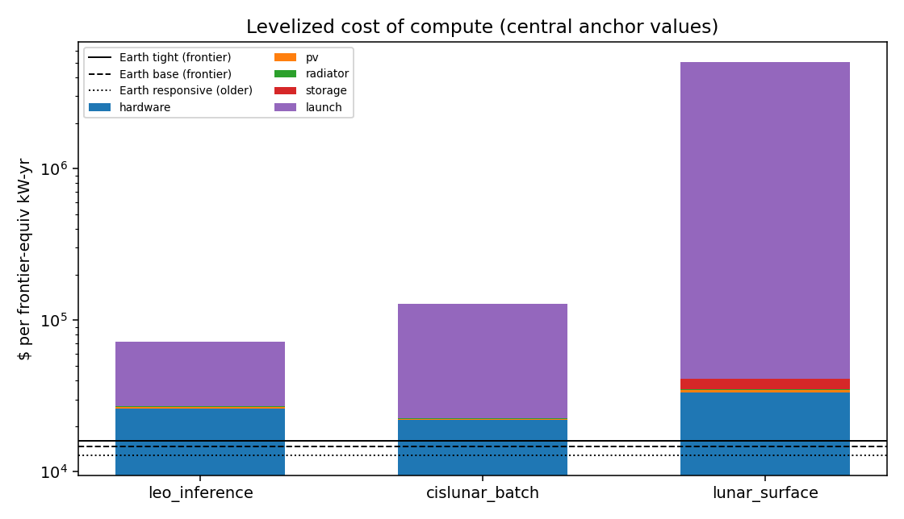
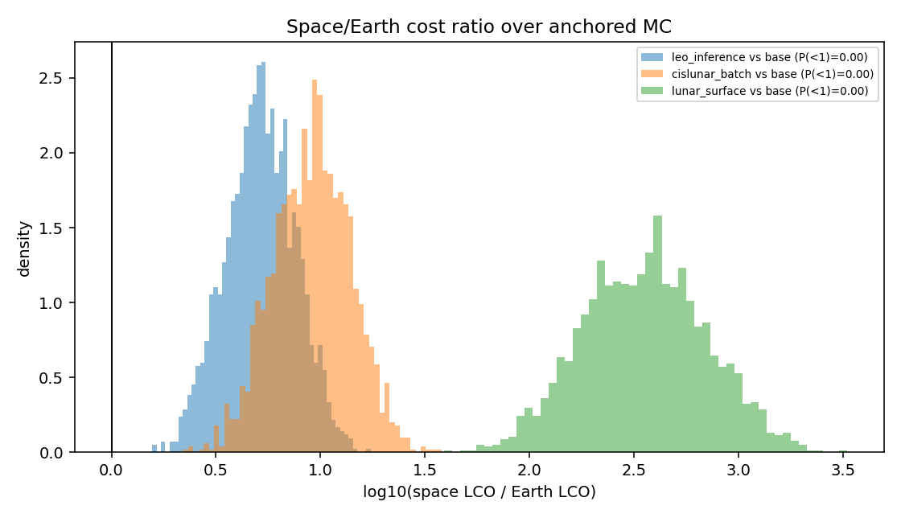
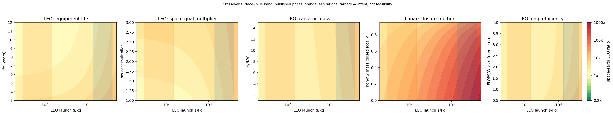

# Part II report: levelized cost of compute, space vs Earth — 2026-07-27

Unit: **$ per frontier-equivalent kW-year of delivered IT load** (older-node
hardware is compute-normalized by its J/FLOP penalty). Three reference cases
(paper Section 9): LEO inference, cislunar batch, lunar-surface compute.
The Earth counterfactual RESPONDS: the responsive scenario prices induced
supply at the nuclear-PPA floor and may deploy older-node hardware.
Aspirational launch targets appear only as sweep axes (rule 3).

## Central anchor values

Space cases (capex $/kW before annualization):

| case | LCO $/kW-yr | launched kg/kW | hardware | pv | radiator | storage | launch |
|---|---|---|---|---|---|---|---|
| leo_inference | 71,901 | 46 | 63,640 | 1,173 | 524 | 0 | 109,205 |
| cislunar_batch | 128,333 | 46 | 63,640 | 1,173 | 524 | 0 | 308,879 |
| lunar_surface | 5,065,254 | 454 | 63,640 | 2,580 | 524 | 11,726 | 9,599,021 |

Earth scenarios:

| scenario | LCO $/kW-yr | node choice |
|---|---|---|
| tight | 15,980 | frontier |
| base | 14,669 | frontier |
| responsive | 12,783 | older |

A calibration check: the Earth base LCO corresponds to ≈ $1.82/kW-hr,
consistent with published accelerator rental rates — the model is anchored at
the right order of magnitude.

## Monte Carlo over anchored ranges (shared draws both sides)

| case | vs Earth | ratio p10/p50/p90 | P(space cheaper) | break-even LEO $/kg p50 (p90) |
|---|---|---|---|---|
| leo_inference | base | 3.1 / 5.2 / 8.4 | 0.000 | -594 (-69) |
| leo_inference | responsive | 3.8 / 6.4 / 10.4 | 0.000 | -737 (-216) |
| cislunar_batch | base | 5.2 / 9.3 / 15.5 | 0.000 | -151 (33) |
| cislunar_batch | responsive | 6.4 / 11.2 / 19.9 | 0.000 | -216 (-29) |
| lunar_surface | base | 147.0 / 359.2 / 877.3 | 0.000 | -12 (-4) |
| lunar_surface | responsive | 183.0 / 453.8 / 1087.6 | 0.000 | -13 (-5) |

Break-even prices are the LEO $/kg at which the space case matches Earth;
**negative means fixed (non-launch) costs alone exceed the Earth cost** — at
those draws no launch price, even zero, closes the gap.

**Sensitivity probe** — everything favorable *within* the anchored ranges at once (qual x1.2, utilization 0.95, radiator 3 kg/kW, life 7 yr): LEO space LCO becomes 36,383 $/kW-yr at central launch prices, and the break-even launch price becomes 27 $/kg — at the bottom edge of the aspirational-target band ($30-150/kg, company statements) and ~50-100x below published prices. Crossover therefore requires the UNANCHORED qual/life/util corner AND the most aggressive target-class launch prices simultaneously; no single anchored number gets there.

**External claim check** — a Google/Planet study (reported by Will Marshall, Moonshots #266, June 2026; recorded as `claims.google_planet_crossover_launch_per_kg`, company_statement, never a model input) puts the crossover at $200-300/kg to LEO. In our model, $250/kg at central anchors gives space/Earth = 2.16 (no crossover); with the favorable corner above it gives 0.93. The claim is therefore reproducible here only under COTS-class qualification (~1.2x), ~7-yr life, and ~0.95 utilization SIMULTANEOUSLY — assumptions consistent with Planet's own practice of flying unmodified Nvidia GPUs at LEO (docs/transcripts/moonshots-266-2026-06-26.md). The disagreement between the claim and our central result is not about launch price at all; it is about the qualification premium, equipment life, and utilization.

The published Suncatcher design study (arXiv:2511.19468v2, 2026-06-17; `claims.suncatcher_launch_feasibility_per_kg`, technical_report) is a LAUNCH-COST FEASIBILITY MARKER, not a crossover claim — its own text says twice it is not a full economic analysis: at $200/kg it compares amortized launch cost per kW-yr against terrestrial electricity spend only, excluding infrastructure, buildings, and chips. Launch-vs-electricity is not system-vs-system; this model supplies the missing system-level comparison, and its negative break-evens quantify exactly what the launch-only framing omits. On radiation: the proton-beam results SUPPORT 5-yr TID survivability with margin (HBM irregularities from ~2 krad vs ~750 rad 5-yr requirement; no hard failures to 15 krad) and do not contradict 7-yr TID; what they do not establish is 7-yr SYSTEM reliability — SEE-induced corruption (core logic/SRAM most sensitive), training-workload impact (reserved by the authors), thermal, and whole-spacecraft failure remain unresolved. Note also the chip-efficiency panel of the crossover figure (r2.10 §16: efficiency is a mass multiplier off Earth — the 'launch tax vs Nvidia tax' argument made quantitative). Our refinement of that argument: at anchored values a 2x FLOPS/W advantage buys only ~2/3 of the benefit of halving launch price (ratio 4.7 vs 3.8 at $3,000/kg), because the hardware term — which efficiency does not touch — is the larger share of both mass and capex. The mass-multiplier mechanism is real but subdominant to the hardware cost channel at central anchors; efficiency dominance emerges only after the qualification premium and hw $/kW fall.

## Figures

## Parameter provenance (anchors used)

| anchor | central value | source_class | note |
|---|---|---|---|
| compute.hw_mass_kg_per_kw | 17.32 | ASSUMPTION | server mass per kW IT stripped of air-cooling chassis; UNANCHORED |
| compute.hw_per_kw_it | 3.354e+04 | reporting | accelerator+system $ per kW of IT load, 2024-26 (H100 ~0.7 kW ~$25-30k; B200 ~1 kW ~$30-40k incl. system share) |
| compute.life_years_earth | 4.243 | technical_report | accelerator refresh cycles (Appendix A: obsolescence-driven) |
| compute.life_years_space | 4.583 | reporting | LEO design lives ~5 yr; radiation + obsolescence for compute payloads |
| compute.ops_fraction_per_year | 0.03464 | ASSUMPTION | ground segment, downlink, ops as fraction of space capex per year |
| compute.power_overhead_space | 1.173 | ASSUMPTION | conversion + pumping losses; the space analogue of PUE |
| compute.space_qual_multiplier | 1.897 | ASSUMPTION | rad-tolerant COTS screening/derating cost factor on hw. Low end has reporting-class support: Planet flies unmodified Nvidia GPUs on Pelican imaging satellites (in-orbit inference demo April 2026, now standard on the line; Moonshots #266, docs/transcripts/moonshots-266-2026-06-26.md) — COTS survives benign LEO for inference-class workloads. Suncatcher proton testing (arXiv:2511.19468v2, 2026-06-17): TPU v6e HBM most TID-sensitive, irregularities from ~2 krad(Si) vs ~750 rad 5-yr shielded requirement (~150 rad/yr), no hard TID failures to 15 krad — SUPPORTS 5-yr TID survivability with margin and does not contradict 7-yr TID; core logic/SRAM most SEE-sensitive, inference error ~1 per 3M inferences, training impact reserved. What remains unresolved is SYSTEM reliability (SEE, training workloads, thermal, whole-spacecraft). High end (hardened, long-life, training-class) remains UNANCHORED |
| compute.utilization_cislunar | 0.9439 | ASSUMPTION | near-continuous sunlight at high orbit |
| compute.utilization_leo | 0.7858 | ASSUMPTION | eclipse fraction (orbit-dependent; dawn-dusk SSO near 1.0) x availability. High end supported by the Suncatcher reference design (81-sat cluster in dawn-dusk sun-synchronous orbit, near-continuous sunlight; r2.10 [S32]) |
| compute.utilization_lunar | 0.6185 | ASSUMPTION | 14-day night: low end = solar+partial storage; high end = polar site / oversized storage |
| earth.dc_capex_per_kw_it | 2e+04 | OVERRIDE | scenario/sweep override |
| earth.gas_power_price_floor_kwh | 0.04899 | reporting | firm CCGT power at shale-gas fuel cost + capex + O&M (Situational Awareness ch. IIIa, 2024, docs/sources/: <$1000/kW plant capex, ~2yr combined-cycle build, Marcellus alone could feed ~150-250 GW). POLITICALLY CONDITIONAL: assumes permitting/climate commitments yield — the responsive scenario's premise; the tight scenario is the politics-binds branch |
| earth.nuclear_ppa_kwh | 0.1082 | reporting | restart PPAs (e.g. TMI ~$100-115/MWh reported 2024); long-run firm clean floor |
| earth.older_node_energy_penalty | 2.121 | technical_report | J/FLOP penalty vs frontier node (~2-3x per 2 process generations) |
| earth.older_node_hw_per_kw | 1.095e+04 | reporting | prior-gen accelerators $/kW IT on secondary/extended supply |
| earth.power_price_kwh | 0.12 | OVERRIDE | scenario/sweep override |
| earth.pue | 1.241 | reporting | hyperscale AI facilities |
| earth.wacc | 0.1095 | ASSUMPTION | capital recovery rate, both sides |
| launch.cislunar_multiplier | 2.828 | ASSUMPTION | $/kg to high orbit / TLI vs LEO; staging + kick stages |
| launch.leo_per_kg | 2,366 | company_statement | published price sheets 2024-26: F9 ~$70M/22.8t ≈ $3.0k/kg; FH reusable ~$97M/~63t ≈ $1.4-1.5k/kg. List prices, not costs |
| launch.lunar_surface_multiplier | 8.944 | ASSUMPTION | landed $/kg vs LEO AT SCALE. Today's CLPS missions are ~$1M/kg (100x LEO); range assumes maturing landers. Wide on purpose |
| power_systems.lunar_storage_kg_per_kwh | 6.325 | technical_report | Li-ion pack-level 100-250 Wh/kg; night-survival storage for lunar surface |
| power_systems.pv_cost_per_kw | 1,000 | reporting | space-qualified array $/kW at volume; terrestrial is ~10x cheaper |
| power_systems.pv_specific_power_w_per_kg | 109.5 | technical_report | flexible blanket arrays; ROSA ~150 W/kg BOL at 1 AU, rigid panels low end |
| power_systems.radiator_cost_per_kw | 447.2 | ASSUMPTION | manufactured cost at volume; UNANCHORED |
| power_systems.radiator_kg_per_kw | 6 | technical_report | deployable radiators at electronics-friendly reject temps; ISS EATCS practice ~6 kg/kW_rejected; advanced concepts 1-3 |
| power_systems.structure_overhead_fraction | 0.3162 | ASSUMPTION | bus/harness/avionics/shielding mass as fraction of (hw+pv+radiator) mass |
